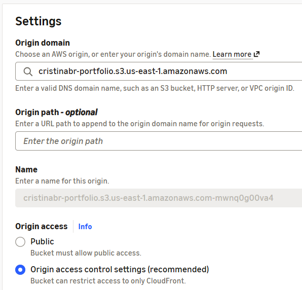
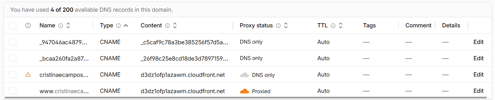
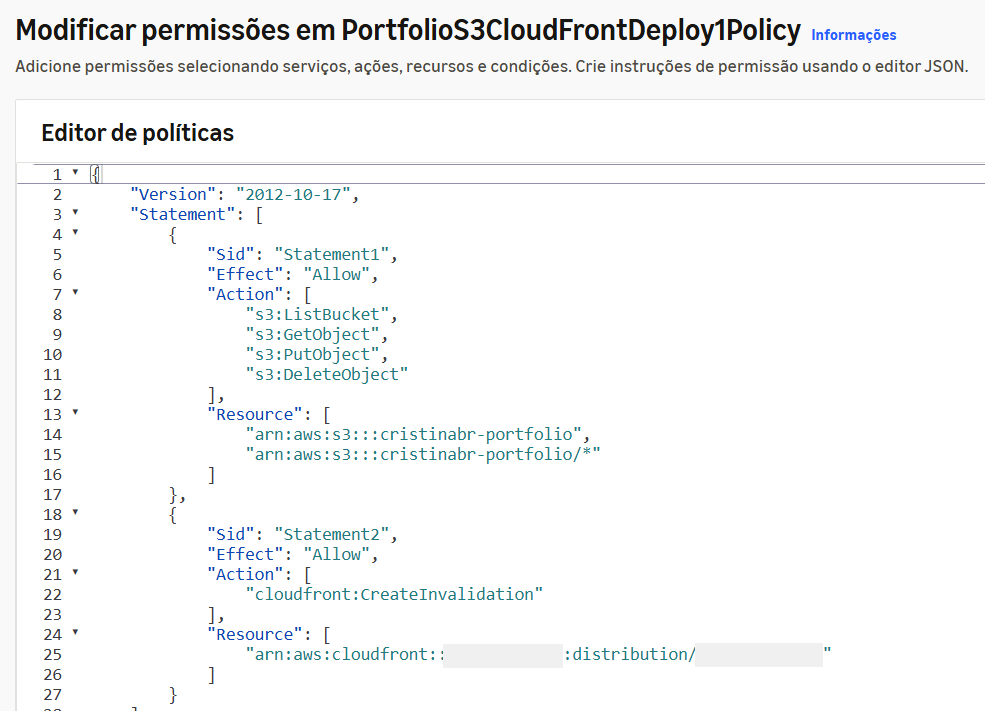
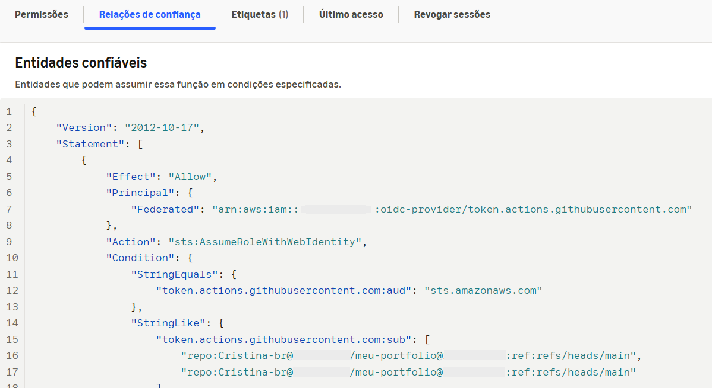

# Lab 01 — Hospedagem Cloud-Native com AWS (S3, CloudFront, ACM), Cloudflare e CI/CD

**Domínio em produção:** [https://cristinaecampos.com.br](https://cristinaecampos.com.br)  
**Repositório:** [Cristina-br/meu-portfolio](https://github.com/Cristina-br/meu-portfolio)  
**Stack:** AWS S3 • Amazon CloudFront • AWS Certificate Manager (ACM) • IAM (OIDC) • Cloudflare DNS • GitHub Actions

---

## 1. Objetivo

Migrar a hospedagem de um portfólio estático (HTML, CSS e JavaScript puro) do GitHub Pages para uma arquitetura **cloud-native na AWS**, aplicando boas práticas de segurança (princípio do menor privilégio, storage privado e autenticação sem credenciais estáticas), entrega global de conteúdo via CDN, gerenciamento de DNS e automação de deploy contínuo (CI/CD).

---

## 2. Arquitetura da Solução

```text
                       [ Usuário / Navegador ]
                                  │
                 ┌────────────────┴────────────────┐
                 ▼                                 ▼
     (cristinaecampos.com.br)           (www.cristinaecampos.com.br)
        Cloudflare DNS                     Cloudflare Proxy (Laranja)
      CNAME Flattening (Cinza)           Redirect Rule 301 ──► Raiz HTTPS
                 │
                 ▼
      [ Amazon CloudFront (CDN) ] ◄── Certificado SSL/TLS (AWS ACM)
                 │
         Origin Access Control (OAC)
                 │
                 ▼
       [ Amazon S3 Bucket ] (Acesso Público Bloqueado)
                 ▲
                 │  aws s3 sync + Invalidação de Cache
      [ GitHub Actions (CI/CD) ] ◄── Autenticação Federada (IAM OIDC)
```

---

## 3. Decisões Técnicas e Implementação

### 3.1. Armazenamento Privado com Amazon S3 + CloudFront (OAC)
* **Decisão:** O bucket S3 foi configurado com **Block All Public Access** ativado (sem *Static Website Hosting* público).
* **Por quê:** Evita a exposição direta do bucket na internet e impede que usuários contornem as políticas de cache e segurança da CDN. O acesso aos objetos é restrito exclusivamente à distribuição do CloudFront por meio de **Origin Access Control (OAC)** e uma *Bucket Policy* específica.



*Figura 1 — Origem S3 configurada com Origin Access Control (OAC) no Amazon CloudFront.*

---

### 3.2. Certificado SSL/TLS Gerenciado com AWS Certificate Manager (ACM)
* **Decisão:** Emissão de certificado SSL/TLS público na região **`us-east-1` (N. Virginia)** cobrindo tanto o domínio raiz (`cristinaecampos.com.br`) quanto o subdomínio (`www.cristinaecampos.com.br`), utilizando validação via DNS.
* **Por quê:** O Amazon CloudFront exige que certificados ACM associados a distribuições globais estejam provisionados na região `us-east-1`. A validação via registros `CNAME` na zona DNS permite que a AWS renove o certificado automaticamente antes do vencimento, sem intervenção manual.

---

### 3.3. Gerenciamento de DNS e Roteamento com Cloudflare
Como o protocolo DNS tradicional não permite registros `CNAME` na raiz de um domínio (zone apex), os *nameservers* do domínio no Registro.br foram delegados para a **Cloudflare**:

* **Domínio raiz (`cristinaecampos.com.br`):** Configurado via **CNAME Flattening** apontando para o endpoint do CloudFront com o proxy desativado (**DNS Only / nuvem cinza**). Isso evita conflitos de duplo proxy e garante que a negociação TLS ocorra diretamente com o certificado do AWS ACM.
* **Subdomínio `www` (`www.cristinaecampos.com.br`):** Configurado com proxy ativado (**Proxied / nuvem laranja**) e uma **Redirect Rule (HTTP 301)** que redireciona permanentemente qualquer requisição para `https://cristinaecampos.com.br`, preservando o caminho (`URI Path`) e os parâmetros (`Query String`).
* **HTTPS Forçado:** Ativado nativamente no *Behavior* do CloudFront (`Redirect HTTP to HTTPS`).



*Figura 2 — Tabela DNS na Cloudflare com CNAME Flattening no domínio raiz e validação CNAME do certificado ACM.*

---

### 3.4. Pipeline de CI/CD Sem Chaves Estáticas (GitHub Actions + OIDC)
* **Decisão:** Em vez de gerar um usuário IAM com `AWS_ACCESS_KEY_ID` e `AWS_SECRET_ACCESS_KEY` fixas, foi configurado um **Identity Provider (OIDC)** no AWS IAM vinculado exclusivamente ao repositório `Cristina-br/meu-portfolio` (branch `main`).
* **Fluxo do Pipeline (`.github/workflows/deploy.yml`):**
  1. Autenticação temporária na AWS via `aws-actions/configure-aws-credentials` assumindo uma *IAM Role* com permissões restritas ao bucket S3 e à distribuição do CloudFront.
  2. Sincronização dos arquivos estáticos com `aws s3 sync . s3://$S3_BUCKET_NAME --delete`, excluindo arquivos internos do repositório (`.git/*`, `.github/*`, `README.md`, `labs/*`).
  3. Criação de invalidação no CloudFront (`/*`) para garantir que alterações no site reflitam imediatamente na borda.



*Figura 3 — Política de permissões (IAM Policy) restrita apenas às operações de sincronização no bucket S3 e invalidação de cache no CloudFront.*

---

## 4. Troubleshooting e Lições Aprendidas

### 4.1. Falha de Autenticação OIDC (`Not authorized to perform sts:AssumeRoleWithWebIdentity`)
* **Sintoma:** Durante a configuração do pipeline no GitHub Actions, o passo `aws-actions/configure-aws-credentials@v4` falhava ao tentar assumir a *IAM Role* na AWS, mesmo com `permissions: id-token: write` e o ARN da role devidamente configurados.
* **Diagnóstico:** A rejeição pelo AWS STS indicava incompatibilidade entre o atributo `sub` (*Subject*) enviado no token JWT pelo GitHub e a condição configurada na *Trust Policy* da *IAM Role*. Para diagnosticar sem suposições, foi adicionado temporariamente um passo de inspeção do token no workflow.
* **Causa Raiz:** O GitHub estava emitindo o token OIDC utilizando o formato estendido com os IDs numéricos imutáveis da conta e do repositório (proteção contra *repository/username hijacking*), enquanto a *Trust Policy* aguardava o formato tradicional baseado apenas nos nomes:
  * **Esperado inicialmente:** `repo:Cristina-br/meu-portfolio:ref:refs/heads/main`
  * **Enviado pelo GitHub:** `repo:Cristina-br@<USER_ID>/meu-portfolio@<REPO_ID>:ref:refs/heads/main`
* **Solução:** Atualização da **Trust Policy** (Relação de Confiança) da *IAM Role* com o `sub` exato contendo os IDs imutáveis do usuário e do repositório, garantindo correspondência estrita sem o uso de curingas (`*`). Após a validação do pipeline, o passo de debug foi removido do YAML e os logs da execução de teste foram excluídos por higiene de segurança.



*Figura 4 — Relação de confiança (Trust Policy) configurada com `StringEquals` e os IDs imutáveis do repositório no GitHub.*

* **Lições:**
  * Diferenciar claramente **Trust Policy** (quem pode assumir a role) de **Permissions Policy** (quais ações a role pode executar na AWS) evita alterações no lugar errado durante o troubleshooting.
  * Utilizar o construtor visual do console IAM para gerar políticas customizadas e revisar o JSON resultante permite aplicar menor privilégio com segurança mesmo sem decorar toda a sintaxe da linguagem de políticas da AWS.
  * Em falhas de OIDC, inspecionar as *claims* reais do token ou consultar os IDs imutáveis via API do GitHub evita tentativas às cegas.

---

### 4.2. Limitação do DNS Nativo do Registro.br com o Amazon CloudFront
* **Sintoma:** Tentativa inicial de gerenciar toda a zona DNS diretamente no painel do Registro.br, porém o sistema não permitia apontar o domínio raiz (`cristinaecampos.com.br`) para o endpoint do CloudFront.
* **Causa Raiz:** O CloudFront fornece um domínio dinâmico (`CNAME` `*.cloudfront.net`) sem endereço IPv4 estático dedicado, enquanto o padrão tradicional de DNS (RFC 1034/1035) utilizado pelo Registro.br não permite registros `CNAME` no ápice da zona (*Zone Apex*).
* **Solução:** Migração dos *nameservers* no Registro.br para a **Cloudflare**, aproveitando o recurso de **CNAME Flattening** para resolver o domínio raiz no nível de DNS sem comprometer a compatibilidade com o CloudFront e o SSL do ACM.

---

## 5. Próximos Passos

* [ ] Implementar backend serverless (AWS Lambda + API Gateway + Amazon SES) para o formulário de contato com envio autenticado pelo domínio próprio (`@cristinaecampos.com.br` e registros SPF/DKIM/DMARC na Cloudflare).
* [ ] Configurar alertas de orçamento no **AWS Budgets** e monitorar métricas de requisições no CloudFront.
* [ ] Evoluir a arquitetura para suportar uma seção de blog técnico no portfólio.
